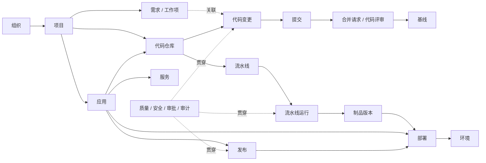

面向复杂 B 端 / DevOps 产品的概念、命名、交互与术语治理规范。

  

- **版本**：v1.1
    
- **文档类型**：产品语言 / UX 规范
    
- **状态**：建议作为设计系统配套规范长期维护

- **更新时间**：2026-08-18

- **本次更新**：补充应用与服务模型、代码协作扩展术语、领域状态词典、界面显示格式、词库治理字段与现有 Demo 迁移清单
    
      
    

## 目录与使用方式

  

	建议阅读顺序：新成员先看第 1–3 章建立共同语言；日常命名优先查第 4–7 章；DevOps 业务命名查第 8–9 章；新增词或发生争议时使用第 10–12 章的决策与治理机制。

  

|   |   |
|---|---|
|**章节**|**内容**|
|01|文档定位与语言体系边界|
|02|语言体系架构与术语分类模型|
|03|统一命名原则|
|04|导航、页面与对象命名规范|
|05|操作动词与交互语言规范|
|06|状态、反馈与消息语言规范|
|07|高频易混淆术语|
|08|DevOps 领域术语模型|
|09|DevOps 标准术语词库|
|10|中英文、缩写与技术术语规则|
|11|术语决策方法与检查清单|
|12|术语治理、变更与废弃机制|
|附录 A|术语条目模板|
|附录 B|快速查询表|

  

> **这份规范如何落地**
> 
>   
> 
> 把“标准术语词库”作为唯一来源（Single Source of Truth）；设计稿、PRD、接口文档、帮助文档中的可见术语均引用同一标准词。若业务必须新增词，先完成定义与边界审查，再进入界面。

  

## 01 文档定位与语言体系边界

  

### 1.1 为什么需要“产品统一语言体系”

  

复杂 B 端产品的术语问题通常不只是措辞不一致，而是概念模型不一致。相同对象被叫成不同名字，会导致用户学习成本、跨团队沟通成本、信息架构漂移和权限/流程规则误解。

  

- 用户侧：同一概念在不同页面出现不同名称，无法形成稳定心智模型。
    
- 产品侧：需求文档中的“项目、空间、应用、服务”等词边界不清，功能重复或职责重叠。
    
- 设计侧：导航、按钮、表单与状态各自命名，局部合理但整体不一致。
    
- 研发侧：前端文案、后端对象名、API 字段和数据库实体之间难以映射。
    
- 治理侧：新业务不断产生新词，旧词又无法废弃，最终形成“同义词堆积”。
    
      
    

### 1.2 本规范覆盖范围

|   |   |   |
|---|---|---|
|**层级**|**覆盖内容**|**示例**|
|概念层|业务实体、属性、关系、规则、生命周期|项目、成员、基线、制品、环境|
|信息架构层|导航、页面、模块、对象详情命名|项目 / 代码 / 流水线 / 制品|
|交互层|按钮、菜单、批量操作、确认动作|新建、添加、移除、归档|
|反馈层|状态、通知、错误、空状态、提示|运行中、失败、已归档|
|技术表达层|英文、缩写、大小写、中英文混排|API、Webhook、Git、DevOps|

  

### 1.3 适用角色

  

产品经理、UX/UI 设计师、研发、测试、技术文档、实施交付、售前及平台治理人员均适用。任何新增可见术语都应能在本体系中找到分类、定义和归属。

  

## 02 语言体系架构与术语分类模型

  

### 2.1 四层语言架构

  

|   |   |   |
|---|---|---|
|**层**|**要解决的问题**|**输出物**|
|L1 概念语言|系统里“有什么”，彼此是什么关系？|领域模型、实体定义、关系定义|
|L2 结构语言|用户在哪里找到它？页面叫什么？|导航、页面标题、对象命名|
|L3 行为语言|用户能对它做什么？|操作动词、按钮、菜单、确认|
|L4 反馈语言|系统现在发生了什么？|状态、结果、错误、通知|

  

> **优先级**
> 
>   
> 
> 发生命名冲突时，优先检查 L1 概念是否定义清楚。不要通过“换一个词”掩盖概念重叠。

  

### 2.2 六类术语模型

  

|   |   |   |   |
|---|---|---|---|
|**类别**|**回答的问题**|**典型形式**|**示例**|
|实体 Entity|它是什么？|名词|项目、需求、仓库、制品|
|属性 Attribute|它具有什么？|名词/名词短语|名称、状态、负责人、版本|
|关系 Relation|它与谁有关？|关系名词/介词关系|所属项目、关联需求、父级|
|操作 Action|可以做什么？|动词|新建、添加、归档、移除|
|状态 State|现在怎么样？|状态词|草稿、运行中、失败、已归档|
|规则 Rule|系统如何运行？|规则/策略/配置项|权限策略、触发规则、保留策略|

  

### 2.3 标准术语条目最小字段

  

任何需要长期维护的术语，至少记录：标准中文名、英文名、定义、术语类型、适用范围、不可替代词/禁用词、易混淆词、示例和维护状态。

  

## 03 统一命名原则

  

|   |   |   |
|---|---|---|
|**原则**|**规则**|**示例**|
|P01 用户语言优先|界面优先使用用户任务和业务语言，不把内部技术实现直接暴露给用户。|Repository → 代码仓库，而非 Repo。|
|P02 一个概念一个标准词|同一语义不要在不同模块使用“人员/用户/成员”等多个近义词。|系统账号主体统一叫“用户”；加入项目后的身份叫“成员”。|
|P03 一个词只指向一个概念|避免同一个词在不同层级含义不同。|“环境”只表示部署运行环境，不同时表示组织空间。|
|P04 名称表达“是什么”|导航与对象名优先用名词，动作通过动词表达。|导航：仓库；按钮：新建仓库。|
|P05 同层级保持同构|同一级导航或同一列表中的命名粒度和语法结构保持一致。|项目 / 需求 / 代码 / 流水线，而非“需求管理 / 代码仓库中心”。|
|P06 短而不失真|能用对象名表达时，不叠加“中心、平台、模块、管理”等弱信息词。|一级导航用“项目”，后台治理页可用“项目管理”。|
|P07 显式区分对象与关系|对象存在性变化和关系变化使用不同动词。|删除用户 ≠ 移除成员。|
|P08 状态使用可验证事实|状态词描述当前事实，不混入原因、建议和下一步。|状态“失败”；原因另写“镜像拉取失败”。|
|P09 同一动作同一动词|跨模块相同语义的动作尽量保持一致，避免局部创新。|统一使用“归档”，不要某处叫“封存”。|
|P10 可扩展与可治理|术语需能支持未来对象扩展，并具有明确负责人和废弃机制。|新术语必须先查词库，再申请新增。|

  

## 04 导航、页面与对象命名规范

  

### 4.1 一级导航：优先使用领域名词

  

一级导航承担领域定位，应优先表达“用户进入的是哪个业务领域”，而不是描述后台能力。

  

|   |   |   |
|---|---|---|
|**推荐**|**避免**|**原因**|
|项目|项目管理|一级导航无需重复“管理”|
|需求|需求中心 / 需求管理|保持同层级简洁一致|
|代码|代码仓库管理|“代码”可作为领域，“仓库”作为二级对象|
|制品|制品管理中心|删除弱信息词|
|发布|发布管理|对象/领域名优先|

  

### 4.2 二级导航：优先使用对象或稳定子领域

  

例如“代码”领域下可使用：仓库、分支、标签、合并请求、基线；“项目”领域下可使用：概览、成员、角色、设置。

  

### 4.3 页面标题：表达当前对象或任务

  

- 列表页：对象复数语义通常直接用对象名，如“用户”“Webhook”“环境”。
    
- 详情页：优先“对象名称”，必要时加对象类型，如“支付服务 · 应用”。
    
- 配置页：对象名 + 配置，例如“流水线配置”。
    
- 设置页：作用域 + 设置，例如“项目设置”“个人设置”。
    
- 后台治理页：当明确维护一类对象时可使用“用户管理”“角色管理”。
    
      
    

### 4.4 “管理 / 配置 / 设置”的使用边界

  

**判断口诀：**有一组对象要维护，用“管理”；有一套规则要定义，用“配置”；有几个行为或偏好要调整，用“设置”。

|   |   |   |   |   |
|---|---|---|---|---|
|**术语**|**核心心智**|**典型动作**|**适用对象**|**示例**|
|管理|维护一组对象|新建、编辑、启停、删除、批量操作|用户、角色、应用、密钥|用户管理、角色管理|
|配置|定义对象或系统如何运行|填写参数、绑定资源、定义规则|流水线、Webhook、代理、部署|流水线配置、Webhook 配置|
|设置|调整默认行为、偏好或能力开关|开关、选择、默认值|个人、项目、仓库、通知|通知设置、仓库设置|

  

### 4.5 对象名称的语法

|   |   |   |
|---|---|---|
|**场景**|**规范**|**示例**|
|业务实体|名词或名词短语|项目、代码仓库、部署环境|
|集合/容器|能表达集合语义时不额外加“列表”|用户、制品、流水线|
|功能页签|优先对象或任务，不写“XX功能”|成员、权限、审计日志|
|详情子页|对象属性/能力名|概览、活动、权限、设置|

  

## 05 操作动词与交互语言规范

  

### 5.1 创建 / 新建 / 添加

  

|   |   |   |   |
|---|---|---|---|
|**词**|**定义**|**推荐场景**|**示例**|
|新建|UI 中创建一个新的独立对象|按钮、菜单|新建项目、新建流水线|
|创建|描述行为或规则时产生新对象|帮助文本、流程说明、系统反馈|创建项目后自动生成默认角色|
|添加|建立“已有对象”与当前对象的关系，或追加条目|成员、标签、规则条目|添加成员、添加标签、添加触发条件|

  

> **关键区别**
> 
>   
> 
> 操作完成后，如果产生一个新的独立实体，使用“新建/创建”；如果只是把已有实体加入某个关系，使用“添加”。

  

### 5.2 删除 / 移除 / 归档

  

|   |   |   |   |
|---|---|---|---|
|**词**|**语义**|**对象结果**|**示例**|
|删除|销毁对象或记录|对象不再存在或不可恢复|删除项目、删除草稿|
|移除|解除关系|对象仍存在|移除项目成员、移除标签|
|归档|退出活跃范围但保留历史|对象保留且通常只读|归档项目、归档需求|

  

### 5.3 编辑 / 修改 / 重命名

  

|   |   |   |
|---|---|---|
|**词**|**建议**|**示例**|
|编辑|作为通用 UI 操作，进入可修改状态|编辑需求、编辑配置|
|修改|用于说明“发生改变”，不作为所有按钮的统一名称|修改成功、修改后立即生效|
|重命名|仅改变名称，不改变其他属性|重命名分支、重命名环境|

  

### 5.4 启用 / 禁用 vs 启动 / 停止 vs 打开 / 关闭

  

|   |   |   |   |
|---|---|---|---|
|**术语对**|**对象类型**|**含义**|**示例**|
|启用 / 禁用|能力、规则、账号、集成|是否允许其生效|启用 Webhook、禁用用户|
|启动 / 停止|可运行实例、任务、服务|运行过程开始/结束|启动流水线、停止任务|
|打开 / 关闭|界面可见性或即时开关|开关某项体验/界面|打开侧边栏；通知开关用“开启/关闭”仅当系统既有风格要求|

  

### 5.5 上传 / 导入，下载 / 导出

  

|   |   |   |
|---|---|---|
|**术语**|**核心含义**|**示例**|
|上传|把文件传到系统，重点是文件传输|上传附件、上传证书|
|导入|把外部数据解析为系统内对象|导入用户、导入需求|
|下载|获取系统中的文件或制品|下载制品、下载日志|
|导出|把系统数据生成外部文件|导出用户、导出报表|

  

### 5.6 复制 / 克隆 / Fork

  

“复制”用于产品层面生成副本；“克隆”用于 Git 等明确的技术语境；“Fork”仅用于代码托管语境且用户群已熟悉时保留英文。不要把三个词作为同义词替换。

  

### 5.7 按钮与菜单写法

  

- 按钮优先使用“动词 + 对象”，对象在上下文唯一时可只保留动词：新建项目 / 保存 / 取消。
    
- 危险操作避免模糊的“确定”，确认按钮应复述动作：删除项目、停止部署。
    
- 批量动作使用“批量 + 动作”仅在需要强调范围时使用；已选中 N 项时可直接写“删除”。
    
- 菜单项保持同一语法，不混用名词与动词：编辑、复制、归档、删除。
    
      
    

## 06 状态、反馈与消息语言规范

  

### 6.1 状态词设计原则

  

- 状态描述“当前事实”，不写成操作指令。
    
- 同一状态轴互斥且尽量完备；不要把生命周期状态与执行状态混在一个字段。
    
- 状态标签使用简短词；原因、时间、责任人放在辅助信息中。
    
- 避免“正常/异常”泛化所有业务，应优先使用具体状态。
    
      
    

### 6.2 通用生命周期状态

  

|           |                             |                   |
| --------- | --------------------------- | ----------------- |
| **状态轴**   | **推荐状态**                    | **说明**            |
| 内容/对象生命周期 | 草稿 → 已发布 → 已归档              | 适用于需求、文档、版本记录等    |
| 执行过程      | 等待中 → 运行中 → 成功 / 失败 / 已取消   | 适用于流水线、任务、部署      |
| 审批过程      | 待审批 → 审批中 → 已通过 / 已拒绝 / 已撤回 | 不要用“成功/失败”替代审批结果  |
| 启用状态      | 已启用 / 已禁用                   | 适用于用户、规则、集成       |
| 健康状态      | 健康 / 警告 / 不可用               | 仅用于可观测健康度，不代替运行状态 |

  

### 6.3 反馈消息结构

  

|   |   |   |
|---|---|---|
|**类型**|**推荐结构**|**示例**|
|成功|结果 + 关键对象|项目已创建|
|失败|动作失败 + 原因 + 可恢复动作|部署失败：目标环境不可用。请检查环境状态后重试。|
|警告|风险事实 + 影响 + 可选动作|删除后将无法恢复，并会移除关联的流水线记录。|
|空状态|现状 + 价值/原因 + 主动作|暂无流水线。创建流水线以自动构建和测试代码。|

  

## 07 高频易混淆术语

  

|   |   |   |
|---|---|---|
|**术语对**|**边界**|**示例**|
|用户 vs 成员|用户：系统账号主体。成员：用户加入某个组织/项目后形成的关系身份。|用户管理；项目成员|
|角色 vs 权限|角色：权限集合及职责载体。权限：对资源执行动作的授权。|开发者角色；代码推送权限|
|项目 vs 项目集|项目：独立交付或研发单元。项目集：多个相关项目的管理集合。|卫星控制软件项目；项目集|
|需求 vs 工作项|需求：表达价值/问题/能力。工作项：可被分派和跟踪的执行对象，可包含需求、任务、缺陷。|用户需求；任务工作项|
|任务 vs 作业|任务：业务协作层的待办。作业 Job：系统执行单元，常由流水线触发。|开发任务；构建作业|
|版本 vs 发布|版本：产品/制品的标识。发布：把选定版本交付到目标范围的过程或记录。|v2.3.0；生产发布|
|环境 vs 集群|环境：面向部署阶段/用途的逻辑运行空间。集群：提供算力的基础设施集合。|测试环境；Kubernetes 集群|
|分支 vs 标签|分支：可继续产生提交的引用。标签：指向特定提交的稳定标记。|main 分支；v1.0.0 标签|
|基线 vs 标签|基线：经过确认、受控的配置项集合/版本状态；标签只是技术引用。|受控基线 BL-2026-08|
|制品 vs 包|制品：构建或交付产生、可追踪版本的交付物；包是其中一种形态。|镜像制品；npm 包|
|部署 vs 发布|部署：把制品安装/运行到环境；发布：面向业务/用户交付一个版本，可包含一个或多个部署。|部署到测试环境；发布 v2.0|
|审计日志 vs 操作日志|审计日志用于合规追溯，强调谁在何时对什么做了什么；操作日志可泛指系统运行记录。|权限变更审计日志|

  

## 08 DevOps 领域术语模型

  

本章定义 DevOps 产品中的核心领域对象及关系。模型用于约束术语边界，不要求界面按模型层级原样展示。导航应服从用户任务，术语定义则服从领域一致性。

  

  

_图 1 · DevOps 领域术语模型（概念层，可直接在支持 Mermaid 的 Markdown 工具中编辑和渲染）_

  

### 8.1 核心关系链

  

组织/身份定义“谁可以参与”；项目定义“在哪个业务边界内协作”；需求定义“为什么做、要交付什么”；代码与基线定义“如何实现并形成受控版本”；流水线完成“自动构建、测试与验证”；制品承载“可交付产物”；环境提供“运行目标”；部署把制品放入环境；发布把一个业务版本正式交付；测试、质量、安全、审计贯穿整个链路。

  

> **一条统一语义链**
> 
>   
> 
> 需求 → 代码变更 → 提交/合并请求 → 基线/源代码版本 → 流水线运行 → 制品版本 → 部署 → 环境 → 发布；质量与审计作为横切能力贯穿全程。

  

### 8.2 领域边界定义

  

|   |   |   |
|---|---|---|
|**领域**|**核心实体**|**边界说明**|
|组织与身份|组织、部门、用户、成员、用户组、角色|解决“谁属于哪里、以什么身份参与”的问题。|
|项目与协作|项目、项目集、成员、里程碑、活动|项目是研发协作和权限/资源聚合的主要业务边界。|
|应用与服务|应用、服务|连接项目、代码、制品与运行交付，描述“交付什么能力”。|
|需求与工作项|需求、任务、缺陷、工作项、迭代|描述价值、问题和执行工作的可追踪单元。|
|代码与配置管理|代码仓库、分支、标签、提交、合并请求、基线|描述源代码、变更、评审和受控版本。|
|持续集成|流水线、阶段、作业、运行、触发器|把代码变更转化为可验证构建结果。|
|制品|制品库、制品、包、镜像、制品版本|保存并追踪构建/交付产物。|
|环境与部署|环境、集群、部署、实例、变量|描述制品运行的位置与部署过程。|
|发布|发布、发布版本、发布单、发布策略|面向用户/业务范围交付一个确定版本。|
|测试与质量|测试计划、测试用例、测试运行、缺陷、质量门禁|验证功能、质量和风险。|
|权限与策略|角色、权限、策略、继承、作用域|约束谁能对哪些资源执行哪些动作。|
|审计与合规|审计事件、审计日志、基线、审批、签署|提供受控研发、合规追溯与证据链。|

  

### 8.3 核心实体关系规则

  

|   |   |   |
|---|---|---|
|**关系**|**定义**|**命名约束**|
|组织 — 项目|一个组织可拥有多个项目；项目通常归属一个主组织。|权限继承和成员来源可由组织向项目下发。|
|用户 — 成员|用户是全局主体；用户加入组织/项目后形成成员关系。|不要把“删除用户”与“移除成员”混用。|
|项目 — 需求|需求在项目作用域内被规划、分派和追踪。|跨项目需求需显式建立关联。|
|项目 — 应用|一个项目可包含多个应用；应用是项目内的逻辑交付单元。|应用不等同于代码仓库或部署实例。|
|应用 — 服务|应用可包含一个或多个对内或对外提供能力的服务。|“服务”不得作为异构功能入口的泛称。|
|应用 — 仓库|应用可关联一个或多个代码仓库，仓库为应用提供源代码。|默认使用“关联”，除非产品模型明确所有权。|
|项目 — 仓库|项目可关联一个或多个代码仓库；仓库也可独立存在后被项目引用，具体取决于产品模型。|界面需明确“归属”还是“关联”。|
|需求 — 代码变更|需求可关联分支、提交、合并请求。|建议以“关联”表达可追踪关系，而非“属于”。|
|仓库 — 基线|基线是仓库/配置项在某一时点经过确认的受控状态。|基线不等同于 Git 标签。|
|流水线 — 制品|流水线运行可产生一个或多个制品版本。|制品需记录来源运行与源代码版本。|
|制品 — 部署|部署选择确定的制品版本并投放到目标环境。|部署记录应指向不可变制品版本。|
|应用 — 部署|部署必须说明部署哪个应用、使用哪个制品版本以及目标环境。|应用状态与部署执行状态分开表达。|
|环境 — 发布|一次发布可包含面向一个或多个环境的部署。|发布是业务交付语义，环境是运行目标。|
|角色 — 权限|角色聚合权限；成员通过角色获得特定作用域的权限。|避免直接把角色等同于权限。|

  

### 8.4 受控研发 / 军工 DevOps 扩展模型

  

对于强调配置管理、基线控制、审批和多库隔离的研发场景，建议在通用 DevOps 模型上扩展“受控状态”和“移交流程”，但不要用新词替代通用概念。

  

|   |   |   |   |
|---|---|---|---|
|**标准词**|**定义**|**与通用概念的关系**|**避免**|
|开发库|面向日常开发和协作的代码仓库/仓库实例。|仍属于“代码仓库”，开发库是用途/管控等级。|开发仓、工作库等多套同义词|
|受控库|承载经过审核并进入受控状态的代码仓库。|强调配置管理和变更受控。|把“受控库”当成独立于仓库的实体类型|
|产品库|承载批准交付/定型版本的代码或配置项。|属于交付阶段的受控仓库。|交付库、成品库混用|
|基线|经正式确认、作为后续活动依据的配置项集合或版本状态。|可由代码、文档、制品等配置项组成。|用“标签”代替基线|
|基线审核|对基线内容、完整性和受控条件进行审批。|审批流程的一种。|基线评审/审核无规则混用|
|移交|在受控边界之间转移经过批准的版本/基线。|不是“复制”；包含审批与证据链语义。|同步、推送、转库混用|
|问题报告|对受控版本发现的问题形成正式追踪记录。|属于工作项/缺陷的受控扩展。|Bug、缺陷、问题单随意混用|

### 8.5 应用、服务与交付关系模型

“应用”和“服务”是当前产品中连接代码与运行交付的关键对象，必须与项目、代码仓库、部署和发布建立稳定关系。

|**标准词**|**定义**|**核心关系**|**避免/边界**|
|---|---|---|---|
|应用|项目作用域内可被配置、构建、部署和发布的逻辑交付单元。|应用可关联一个或多个代码仓库、流水线、制品和环境。|不等同于代码仓库，也不等同于某次部署产生的实例。|
|服务|应用对内或对外提供的可运行能力。一个应用可包含一个或多个服务。|服务由应用交付，可通过部署实例运行在环境中。|不要用“服务”泛指工作项、仓库、测试计划等导航入口。|
|部署|把确定的制品版本投放并运行到目标环境。|部署必须关联应用、制品版本和环境，并形成可追踪记录。|不使用“发布”代替技术部署过程。|
|发布|按策略把确定的业务版本交付到目标用户或环境范围。|一次发布可编排一个或多个部署，并可包含审批、验证和回滚策略。|不使用“部署”代替业务交付过程。|
|发布编排|定义一次发布中环境顺序、部署批次、审批门禁和回滚方式的规则集合。|属于发布的配置或执行计划。|不是流水线编排，也不是单次部署。|

应用关系命名约束：

- 项目与应用之间使用“归属项目”或“项目应用”，不要写成“项目服务”代替应用。
- 应用与代码仓库之间默认使用“关联代码仓库”；只有数据模型明确拥有关系时才使用“所属仓库”。
- 应用与制品之间使用“当前部署制品”“候选制品版本”等明确关系，不使用裸词“当前版本”。
- 应用运行状态、启用状态、最近部署状态必须使用不同字段，不合并为一个“状态”。

### 8.6 代码协作扩展模型

|**标准词**|**类型**|**定义**|**推荐界面用法**|**避免/边界**|
|---|---|---|---|---|
|仓库组|实体/容器|用于组织多个代码仓库的逻辑容器。|仓库组、所属仓库组|不等同于项目或代码仓库；若产品使用 Namespace，应统一中文映射。|
|代码变更|抽象实体|一次或一组可追踪的代码差异，可由提交或合并请求承载。|关联代码变更、变更文件|不要用“修改”泛指所有可追踪变更。|
|代码评审记录|记录|一次代码评审中的意见、决策和参与者记录。|代码评审、代码评审记录|页面展示评审活动时优先“代码评审”；只有历史记录集合才使用“记录”。|
|变更追溯|能力/活动|按文件、代码行、提交和作者追踪代码变更来源。|变更追溯、文件历史|“修改追溯”作为旧词逐步废弃。|
|提交签名验证|活动/结果|验证提交签名与提交者身份关联是否有效。|签名有效、签名无效、未签名|避免只写含义不清的“已验证”。|
|来源分支|关系属性|合并请求中提供待合并变更的分支。|来源分支|不要用“仓库标签”指代分支。|
|目标分支|关系属性|合并请求中接收变更的分支。|目标分支|不要只依赖箭头表达关系。|
|默认分支|属性|代码仓库默认展示和操作的分支。|默认分支|它可以同时是保护分支，不作为互斥状态。|
|保护分支|属性/规则|受权限和合并策略保护的分支。|保护分支、分支保护规则|不与“普通分支”组成生命周期状态轴。|
|构建|活动|把源代码转换为可验证输出或制品的过程。|触发构建、构建结果|构建可由流水线作业执行，但不等同于流水线。|
|集成|实体/关系|连接外部系统并交换事件或数据的配置关系。|服务集成、启用集成|Webhook 是集成机制之一，不代表所有集成。|

  

## 09 DevOps 标准术语词库

  

下表可作为 v1.1 初始词库。实际落地时应维护在可检索知识库或设计系统站点中，并为每条术语增加负责人、创建日期、状态和变更记录。

  

|   |   |   |   |   |
|---|---|---|---|---|
|**标准词**|**英文**|**类型**|**定义**|**避免/边界**|
|组织|Organization|实体|承载人员、项目和治理规则的顶层业务边界。|公司、租户（除非确有租户概念）|
|部门|Department|实体|组织结构中的行政或业务单元。|团队（若团队不是行政结构）|
|用户|User|实体|系统中的账号主体。|人员、账号（账号用于认证属性时除外）|
|成员|Member|关系实体|用户加入组织、项目或团队后形成的成员关系。|用户（在成员语境下）|
|用户组|Group|实体|用于批量授权或协作的用户集合。|用户群、人员组|
|角色|Role|实体/规则|一组职责和权限的集合，可授予成员。|权限组|
|权限|Permission|规则|主体对资源执行特定动作的授权。|能力（除非产品另有能力模型）|
|策略|Policy|规则|可复用的条件、约束与决策规则集合。|规则（两者需定义层级时）|
|项目|Project|实体|围绕确定目标组织人员、需求、代码与交付资源的协作边界。|空间、工作区（除非另有定义）|
|项目集|Program|实体|用于统筹多个相关项目的管理集合。|项目组|
|应用|Application|实体|项目作用域内可被配置、构建、部署和发布的逻辑交付单元。|代码仓库、部署实例|
|服务|Service|实体|应用对内或对外提供的可运行能力。|不要泛指工作项、仓库、测试计划等功能入口|
|需求|Requirement|实体|描述用户/业务问题、价值或期望能力的可追踪对象。|任务|
|工作项|Work Item|抽象实体|可被分派、跟踪和流转的工作对象总称。|工单（除非工单是独立领域）|
|任务|Task|实体|需要执行并完成的具体工作项。|作业|
|缺陷|Defect|实体|产品或系统偏离预期行为的问题记录。|Bug（面向非技术用户时）|
|迭代|Iteration|实体|在固定或约定周期内组织工作项的计划单元。|冲刺（仅 Scrum 语境用 Sprint/冲刺）|
|里程碑|Milestone|实体|标记关键目标或交付节点的计划对象。|阶段|
|代码仓库|Repository|实体|存储和管理版本化源代码及相关文件的代码管理对象。|Repo（界面默认不使用缩写）|
|仓库组|Repository Group / Namespace|实体/容器|用于组织多个代码仓库的逻辑容器。|项目、代码仓库|
|分支|Branch|实体|可继续产生提交的代码版本引用。|代码线|
|标签|Tag|实体|指向特定提交/对象的稳定标记。|版本（标签可承载版本号但不等于版本）|
|提交|Commit|实体|对代码仓库的一次不可变版本记录。|提交记录（可在说明中使用）|
|源代码版本|Source Code Version|属性/实体|由确定提交、标签或基线标识的源代码状态。|标签、基线（它们是标识或受控状态，不等同于版本本身）|
|合并请求|Merge Request|实体|请求将一个分支的变更合并到另一分支的协作与评审对象。|PR（除非产品决定使用 Pull Request）|
|代码评审|Code Review|活动|对代码变更进行审查、讨论和批准的活动。|审核（泛化）|
|代码评审记录|Code Review Record|记录|代码评审中的意见、决策、参与者及时间记录。|代码评审活动本身|
|代码变更|Code Change|抽象实体|一次或一组可追踪的代码差异，可由提交或合并请求承载。|修改（过于泛化）|
|变更追溯|Change Traceability|能力/活动|按文件、代码行、提交和作者追踪代码变更来源。|修改追溯|
|提交签名验证|Commit Signature Verification|活动/结果|验证提交签名与提交者身份关联是否有效。|已验证（含义不清）|
|基线|Baseline|实体/状态|经正式确认并受控的配置项集合或版本状态。|标签、版本|
|流水线|Pipeline|实体|由阶段/作业组成的自动化构建、测试、交付流程定义。|流程（过于泛化）|
|流水线运行|Pipeline Run|实体|流水线定义的一次具体执行实例。|流水线实例（如无必要）|
|构建|Build|活动|把源代码转换为可验证输出或制品的过程。|流水线（构建可由流水线执行，但二者不等同）|
|阶段|Stage|实体|流水线中按顺序或依赖组织的一组作业。|步骤|
|作业|Job|实体|流水线中的可执行工作单元。|任务|
|步骤|Step|实体|作业内部的最小执行步骤。|阶段|
|触发器|Trigger|规则/实体|决定流水线何时被触发执行的条件。|钩子（除非指 Webhook）|
|制品库|Artifact Repository|实体|存储、版本化和分发制品的仓库。|制品仓（统一选一）|
|制品|Artifact|实体|由构建、打包或交付过程产生的可追踪产物。|包（包只是制品类型）|
|制品版本|Artifact Version|实体|制品的确定、可追踪版本。|版本包|
|镜像|Image|实体|可部署的容器镜像制品。|镜像包|
|环境|Environment|实体|面向开发、测试、预生产或生产用途的逻辑运行空间。|集群|
|集群|Cluster|实体|提供计算、网络等运行能力的基础设施集合。|环境|
|部署|Deployment|实体/活动|将确定制品版本投放并运行到目标环境的过程或记录。|发布|
|部署实例|Deployment Instance|实体|一次部署产生的可运行实例或部署记录。|发布实例|
|发布|Release|实体/活动|将确定版本按策略交付到目标用户/环境范围的业务过程。|部署|
|发布版本|Release Version|实体|一次发布所对应的业务版本标识。|制品版本|
|发布编排|Release Orchestration|规则/活动|定义发布中的环境顺序、部署批次、审批门禁和回滚方式。|流水线编排、单次部署|
|移交|Transfer|活动/实体|在受控边界之间转移经过批准的版本或基线并保留证据链。|入库、同步、推送、转库（语义不明确时）|
|测试计划|Test Plan|实体|组织测试范围、策略、周期和资源的计划对象。|测试任务|
|测试用例|Test Case|实体|定义前置条件、步骤和预期结果的可执行测试规格。|测试场景（若未单独定义）|
|测试运行|Test Run|实体|对一组测试用例的一次执行记录。|测试执行（可作活动描述）|
|质量门禁|Quality Gate|规则|基于质量指标决定是否允许进入下一阶段的规则。|质量规则（如规则粒度不同）|
|审批|Approval|活动/实体|由指定审批人对某个动作、版本或对象作出通过/拒绝决策的过程。|审核（若系统已统一“审批”）|
|审计日志|Audit Log|实体|用于合规追溯的不可抵赖或受控操作记录。|操作日志|
|Webhook|Webhook|实体/集成|基于事件向外部 URL 主动发送 HTTP 请求的集成机制。|回调（泛化）|
|集成|Integration|实体/关系|连接外部系统并交换事件或数据的配置关系。|Webhook（Webhook 只是集成机制之一）|
|API|API|技术术语|系统间以程序方式访问能力的接口。|接口（当会与 UI 接口混淆时）|
|令牌|Token|实体|用于认证、授权或短期访问的凭证字符串。|密钥（Key 与 Token 需区分）|
|密钥|Key / Secret|实体|用于签名、加密或身份验证的秘密凭证。|令牌|
|变量|Variable|属性/实体|在流水线、环境或部署过程中引用的命名值。|参数（若参数另有语义）|

### 9.1 领域状态词典

通用状态只能作为上位规范。进入具体业务页面时，必须先确定对象和状态轴。同一字段中的状态必须互斥；不同状态轴不得合并到一个“状态”字段。

#### 9.1.1 代码仓库与分支

|**对象**|**状态轴**|**推荐状态/属性**|**说明**|
|---|---|---|---|
|代码仓库|生命周期|活跃、已归档|“已锁定”属于访问控制状态，不与生命周期混用。|
|代码仓库|访问状态|可写、只读、已锁定|正常情况下可不展示“可写”，只展示异常或受限状态。|
|分支|活跃状态|活跃、已过时|描述分支相对默认分支的维护状态。|
|分支|属性|默认分支、保护分支|属性可以同时成立，必须允许组合筛选。|
|提交签名|验证结果|签名有效、签名无效、未签名|不要使用缺少验证对象的“已验证”。|

#### 9.1.2 合并请求

推荐生命周期：

`草稿 → 进行中 → 已合并 / 已关闭 / 已拒绝`

|**状态**|**定义**|**是否终态**|
|---|---|---|
|草稿|尚未正式请求评审和合并。|否|
|进行中|已发起，正在评审、等待检查或等待合并。|否|
|已合并|变更已经合并到目标分支。|是|
|已关闭|未合并并由发起人或维护者关闭。|是|
|已拒绝|经过评审或审批后明确不接受该变更。|是|

不得把“草稿”合并显示为“进行中”，也不得把“已拒绝”无差别归入“已关闭”。如果产品不提供拒绝动作，则删除“已拒绝”状态。

#### 9.1.3 应用、部署与环境

|**对象**|**状态轴**|**推荐状态**|**说明**|
|---|---|---|---|
|应用|启用状态|已启用、已禁用|表示应用是否允许被操作或参与交付。|
|应用|配置状态|未配置、配置中、已就绪|仅在确实存在配置完成条件时使用。|
|部署|执行状态|等待中、运行中、成功、失败、已取消|“已部署”可作为摘要结果，不应替代完整执行状态。|
|环境|健康状态|健康、警告、不可用|不要使用“运行正常”“运行异常”等泛化表达。|
|环境|启用状态|已启用、已禁用|与健康状态、最近部署状态分别展示。|
|发布|生命周期|草稿、待发布、发布中、已发布、已取消|审批状态需单独使用审批状态轴。|
|发布|审批状态|待审批、审批中、已通过、已拒绝、已撤回|不要使用“成功/失败”描述审批结果。|

#### 9.1.4 流水线与测试

|**对象**|**状态轴**|**推荐状态**|**说明**|
|---|---|---|---|
|流水线|启用状态|已启用、已禁用|流水线定义是否允许被触发。|
|流水线运行|执行状态|等待中、运行中、成功、失败、已取消|与流水线定义状态分开。|
|测试计划|生命周期|草稿、进行中、已完成、已归档|“进行中”表示计划处于执行周期。|
|测试运行|执行状态|等待中、运行中、通过、失败、已取消|“通过/失败”表达测试结果。|
|缺陷|生命周期|新建、处理中、待验证、已解决、已关闭、重新打开|实际采用前应由测试领域 Owner 确认流转规则。|

### 9.2 状态展示规则

- 状态标签只显示当前事实；原因通过辅助文本、Tooltip 或详情字段展示。
- 状态颜色由语义决定，不使用颜色替代状态文字。
- 同一状态在列表、详情、筛选、统计和消息中使用完全相同的中文名称。
- 聚合筛选项可以使用“全部”，但“全部”不是对象状态。
- 属性筛选与状态筛选必须分开命名，例如“分支属性”与“活跃状态”。

  

## 10 中英文、缩写与技术术语规则

  

### 10.1 英文保留原则

  

|   |   |   |
|---|---|---|
|**类型**|**规则**|**示例**|
|行业通用缩写|用户普遍熟悉且中文展开更长时保留|API、SDK、CI/CD|
|协议/技术名|作为专有技术名称保留|Git、SSH、OAuth、Kubernetes|
|产品概念已有成熟中文|优先中文，必要时首次出现附英文|代码仓库（Repository）、合并请求（Merge Request）|
|产品自定义概念|优先稳定中文名，同时维护英文映射|基线（Baseline）|

  

### 10.2 大小写与中英文混排

  

- 英文缩写使用行业标准大小写：API、SDK、URL、HTTP、SSH。
    
- 产品名/技术名遵循官方写法：GitHub、GitLab、Kubernetes、DevOps、Webhook。
    
- 中文与英文/数字之间保留一个半角空格：Git 仓库、API Token、v2.0 版本。
    
- 路径、代码、命令、变量名不强制插入中文空格。
    
- 同一产品内 Merge Request 与 Pull Request 二选一，不混用 MR/PR 作为面向普通用户的默认术语。
    
      
    

### 10.3 缩写规则

  

缩写只有在“高频、明确、稳定”三个条件同时满足时才进入 UI。首次在长文档中出现可写“持续集成（CI）”，后续再使用 CI；按钮、导航不使用用户无法解释的内部缩写。

### 10.4 日期、数量与技术单位

| **类型** | **规则**                               | **推荐示例**          | **避免**                    |
| ------ | ------------------------------------ | ----------------- | ------------------------- |
| 绝对日期时间 | 统一使用 `YYYY/MM/DD HH:mm:ss`；不需要秒时省略秒。 | 2026/08/11 09:18  | 2026-08-11、08月11日与连字符格式混用 |
| 相对时间   | 适用于动态列表和近期活动；应能通过 Tooltip 或详情查看绝对时间。 | 4 分钟前、3 天前        | 同一列表混用绝对时间和相对时间           |
| 文件大小   | 数值与单位之间保留一个半角空格，单位使用标准大小写。           | 0.55 KB、12.4 MB   | 0.55kb、12mb               |
| 对象计数   | 使用稳定量词，并在同一对象中保持一致。                  | 4 个提交、3 条评论、2 个标签 | 4 提交、3 评论                 |
| 版本号    | 版本标识按原值展示；与中文组合时保留空格。                | 发布 v2.0、v2.0 版本   | 发布v2.0                    |
| 百分比    | 数字与 `%` 之间不加空格。                      | 72%               | 72 %                      |

推荐量词：项目、应用、环境、流水线、提交和标签使用“个”；需求、任务和缺陷使用“项”；评论和记录使用“条”；文件使用“个”。

### 10.5 标点、分隔与字段名称

- 并列字段优先拆成独立列；确需合并时使用 `/`，不使用 `&` 或全角竖线字符表达字段关系。
- 元信息之间优先使用 Divider 组件或中点 `·`，同一页面只选一种模式。
- 来源分支与目标分支必须通过字段名或方向箭头共同表达，不使用“仓库标签”等无关词占位。
- 列表页对象主字段优先使用“对象名 + 名称”，例如“应用名称”“分支名称”；不要在所有对象中统一使用“标题”。
- 裸词“版本”可能同时指制品版本、发布版本或标签承载的版本号，界面字段必须写明“制品版本”“发布版本”等限定语。

### 10.6 搜索、筛选与空状态

- 聚合筛选默认项统一使用“全部”，例如“全部状态”“全部创建人”；不与“所有”混用。
- 筛选按钮应显示筛选维度，而不是直接复用某个状态词，例如“创建人”“创建时间”“分支属性”。
- 搜索占位符应对应真实可搜索字段，不全局复用“标题/编号/描述关键字”。

|**对象**|**推荐占位符**|
|---|---|
|应用|搜索应用名称或描述|
|代码仓库|搜索仓库名称、标识或描述|
|分支|搜索分支名称|
|提交|搜索提交 ID、提交信息或提交人|
|标签|搜索标签名称或描述|
|合并请求|搜索标题、编号或分支名称|
|环境|搜索环境名称或描述|

空状态统一使用“现状 + 原因/价值 + 主动作”。筛选无结果时使用“未找到符合条件的 {对象}。请调整搜索或筛选条件。”；对象尚未创建时使用“暂无 {对象}。{新建对象的价值说明}。”

  

## 11 术语决策方法与检查清单

  

### 11.1 新名称决策流程

  

1. 先判断它属于实体、属性、关系、操作、状态还是规则。
    
2. 查询标准词库，确认是否已有同一概念或上位概念。
    
3. 明确概念边界：它与最相近的两个术语有什么不同？
    
4. 选择用户最熟悉且最短的业务表达，避免内部实现词。
    
5. 把名称放进真实上下文验证：导航、页面标题、按钮、状态、帮助文本。
    
6. 验证跨模块一致性和未来扩展性。
    
7. 通过术语评审后加入词库，再进入设计与研发。
    
      
    

### 11.2 “管理 / 配置 / 设置”决策树

  

|   |   |   |
|---|---|---|
|**问题**|**是**|**否**|
|用户是在维护一组可独立存在的对象吗？|使用“管理”，或直接用对象名|继续判断|
|用户是在定义对象/系统的运行参数、规则和资源关系吗？|使用“配置”|继续判断|
|用户是在调整偏好、默认行为或能力开关吗？|使用“设置”|优先直接使用具体对象/任务名称|

  

### 11.3 发布前术语检查清单

  

- 同一概念是否在所有页面使用同一标准词？
    
- 是否存在一个词同时表示两个不同概念？
    
- 导航同一级名称是否同构、同粒度？
    
- 按钮是否清楚表达动作，而不是“确定/处理/操作”等泛化词？
    
- 删除与移除、创建与添加、发布与部署是否被正确区分？
    
- 状态是否描述当前事实，且同一状态轴互斥？
    
- 技术术语是否真的需要暴露给当前用户？
    
- 英文缩写、大小写和空格是否符合统一规则？
    
- 新增词是否已登记定义、边界、英文映射和负责人？
    
      
    

## 12 术语治理、变更与废弃机制

  

### 12.1 角色与职责

  

|   |   |
|---|---|
|**角色**|**职责**|
|语言规范 Owner|维护规范结构、仲裁跨领域命名、管理版本。|
|领域 Owner|维护本领域模型和术语定义，提出新增/变更。|
|UX/内容设计|验证用户理解、界面语境和跨模块一致性。|
|研发/架构|提供技术边界与对象关系，避免术语与实现模型完全脱节。|
|文档/测试|检查帮助文档、验收用例和界面是否引用标准术语。|

  

### 12.2 新术语准入流程

  

发现命名需求 → 查询词库 → 判断是否可复用现有术语 → 定义概念及边界 → 领域评审 → UX 语言评审 → 发布为“推荐” → 产品使用 → 定期复盘。

  

### 12.3 术语状态

  

|   |   |   |
|---|---|---|
|**状态**|**含义**|**使用规则**|
|Draft 草案|正在讨论，尚未正式采用。|不得作为跨产品强制标准。|
|Recommended 推荐|当前标准术语。|新设计必须使用。|
|Deprecated 已废弃|停止新增使用，保留历史兼容。|旧页面按版本计划迁移。|
|Reserved 保留|暂不在 UI 使用，但为模型或未来能力保留。|需说明原因。|

  

### 12.4 变更规则

  

- 语义不变仅改措辞：记录旧词 → 新词、迁移范围和版本。
    
- 概念边界发生变化：必须更新领域模型、上下游术语和数据映射。
    
- 大规模替换不要求一次完成，但新页面禁止继续使用 Deprecated 词。
    
- 高风险术语（权限、删除、发布、审批、受控/基线等）变更需经过跨职能评审。

### 12.5 词库交付结构

第 9 章表格是便于阅读的词库快照，不作为完整治理数据结构。正式的术语 Single Source of Truth 必须为每个条目维护以下字段：

|**字段**|**是否必填**|**说明**|
|---|---|---|
|术语 ID|是|稳定且不可复用的唯一标识，例如 `TERM-CODE-001`。|
|标准中文名|是|界面默认使用的唯一标准名称。|
|英文名|是|技术、国际化、API 和文档映射名称。|
|术语类型|是|实体、属性、关系、操作、状态或规则。|
|定义|是|说明“它是什么”，不能用同义词循环定义。|
|适用范围|是|系统级、组织级、项目级或具体领域。|
|边界|是|至少说明与一个相近术语的差异。|
|推荐示例|是|至少一个真实界面或业务句子。|
|禁用词/旧词|否|需要阻止新增使用或计划迁移的表达。|
|状态|是|Draft、Recommended、Deprecated 或 Reserved。|
|领域 Owner|是|负责定义和业务边界。|
|语言 Owner|是|负责界面表达和跨模块一致性。|
|引入版本|是|首次进入标准词库的版本。|
|废弃版本|否|被标记为 Deprecated 的版本。|
|替代术语 ID|否|废弃后指向的标准术语。|
|变更记录|是|记录日期、修改人、原因和影响范围。|

设计稿、前端代码、接口文档和帮助文档应引用术语 ID 或可追踪的标准词来源，避免复制后形成多个不可同步的词库副本。

### 12.6 当前 Demo 首批迁移清单

下表是 v1.1 针对当前 Demo 的首批迁移基线。新页面不得继续新增左侧旧词；既有页面可按优先级渐进替换。

|**当前表达**|**标准表达/处理方式**|**原因**|**优先级**|
|---|---|---|---|
|项目管理、需求管理、代码管理、制品管理、测试管理|项目、需求、代码、制品、测试|一级导航使用领域名词，删除弱信息词“管理”。|P0|
|部署管理|部署或发布|先确认页面承载技术部署还是业务发布，不允许混用。|P0|
|制品仓库|制品库|采用标准术语 Artifact Repository 的唯一中文名。|P0|
|应用管理、环境管理|应用、环境|二级导航直接使用对象名。|P1|
|测试缺陷|缺陷|测试领域上下文已明确，不重复前缀。|P1|
|工作项入口跳转到需求页面|拆分工作项与需求页面|需求是工作项的一种，不是同一对象。|P0|
|服务（作为异构快捷入口分组）|常用或快捷入口|避免与可运行的 Service 实体冲突。|P0|
|创建分支|新建分支|UI 中创建独立对象使用“新建”。|P1|
|已成功新建|分支已创建、标签已创建|成功反馈使用“结果 + 关键对象”。|P1|
|开启、开启中|进行中|合并请求状态统一使用一个标准词。|P1|
|所有|全部|统一聚合筛选默认项。|P2|
|已验证|签名有效|明确验证对象和结果；若不是签名验证，应重新定义。|P1|
|Webhook 设置|Webhook 配置|Webhook 页面定义 URL、事件和规则，属于配置。|P1|
|新建 webhook|新建 Webhook|遵循技术名官方大小写。|P2|
|Zip|ZIP|英文缩写使用标准大小写。|P2|
|应用列表|应用|集合页标题不增加“列表”。|P2|
|标题（应用表格）|应用名称|字段名应说明所属对象。|P2|
|当前版本|当前制品版本或当前发布版本|避免裸词“版本”造成概念歧义。|P1|
|运行正常、运行异常|健康、警告、不可用|环境使用健康状态轴。|P1|
|默认分支、保护分支、普通分支（作为状态）|分支属性|这些概念可以重叠，不属于互斥状态。|P1|
|评审记录|代码评审或代码评审记录|根据页面展示活动还是历史记录选择。|P1|
|入库记录|移交记录|若表示受控边界转移，使用受控研发标准词“移交”。|P1|
|修改追溯|变更追溯|与代码变更概念保持一致。|P2|
|仓库标签（合并请求元信息）|来源分支 / 目标分支|避免与 Git 标签概念冲突。|P1|
|0.55kb|0.55 KB|统一技术单位大小写和空格。|P2|
|4 提交、3 评论|4 个提交、3 条评论|统一对象量词。|P2|
|开始时间 & 部署时长|拆为两个字段，或使用“开始时间 / 部署时长”|并列属性优先拆分，不使用 `&`。|P2|
    
      
    

## 附录 A 术语条目模板

  

|   |   |
|---|---|
|**字段**|**填写要求**|
|标准中文名|界面默认使用的唯一标准名称。|
|英文名|技术、国际化与文档映射名称。|
|术语类型|实体 / 属性 / 关系 / 操作 / 状态 / 规则。|
|定义|用一句话说明“它是什么”，避免用同义词循环定义。|
|适用范围|系统级 / 组织级 / 项目级 / 代码域 / 发布域等。|
|边界|至少说明与 1–2 个近似术语的差异。|
|推荐示例|真实 UI 或业务句子。|
|避免/禁用词|旧词、同义词、易误解词。|
|状态|Draft / Recommended / Deprecated / Reserved。|
|Owner|领域或规范负责人。|
|版本记录|新增、修改、废弃的版本与原因。|

  

> **模板示例：成员**
> 
>   
> 
> 标准词：成员 Member｜类型：关系实体｜定义：用户加入某个组织或项目后形成的成员关系。边界：用户是系统级账号主体；成员只在特定作用域存在。推荐：添加成员、移除成员。避免：删除成员（若对象用户仍存在）。

  

## 附录 B 快速查询表

  

|   |   |   |
|---|---|---|
|**用户意图**|**推荐术语**|**示例**|
|维护一组对象|管理 / 或直接对象名|用户管理；一级导航直接“用户”|
|定义运行规则|配置|流水线配置|
|调整偏好/默认行为|设置|通知设置|
|产生新独立对象|新建 / 创建|新建项目|
|建立已有对象关系|添加|添加成员|
|销毁对象|删除|删除项目|
|解除对象关系|移除|移除成员|
|退出活跃范围保留历史|归档|归档需求|
|允许运行/生效|启用|启用 Webhook|
|开始执行过程|启动|启动流水线|
|把外部文件传入|上传|上传证书|
|把外部数据转成系统对象|导入|导入用户|
|获取已有文件|下载|下载制品|
|生成外部数据文件|导出|导出报表|
|把制品放到环境|部署|部署到测试环境|
|面向业务交付版本|发布|发布 v2.0|

  

## 结语：把术语当作产品架构的一部分

  

B 端产品的语言不是界面最后一层“润色”，而是领域模型在用户界面中的外显。术语统一的最高目标，是让用户看到一个词，就能稳定预测对象是什么、能做什么、当前处于什么状态，以及它和其他对象是什么关系。

  

> **v1.1 建议落地动作**
> 
>   
> 
> ① 将本规范纳入设计系统；② 建立可检索术语词库；③ 以第 12.6 节迁移清单治理当前 Demo；④ 为应用、服务、部署和发布指定领域 Owner；⑤ 在设计/需求评审中增加“术语一致性”检查项；⑥ 为新增界面文案建立自动检查或人工验收门禁。
